# Панель-Service

Веб-панель для администрирования подключений приложения [Service](https://github.com/pasha-tsaran/Service). Администратор управляет пользователями, подписками, устройствами и серверами, выдаёт доступ и отслеживает нагрузку.

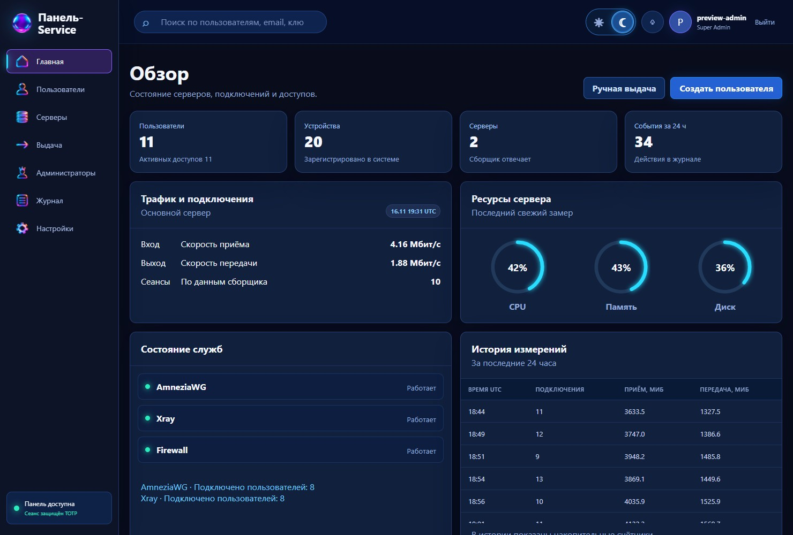

## Разделы панели

<details>
<summary>Вход</summary>

Вход администратора по паролю и одноразовому коду TOTP.

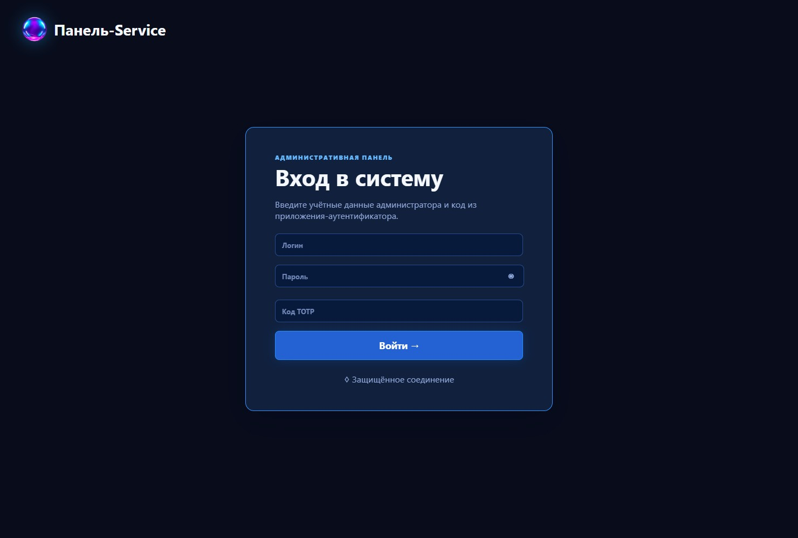

</details>

<details>
<summary>Обзор</summary>

Активные подключения, скорость входящего и исходящего трафика, загрузка сервера, состояние служб и история замеров.


</details>

<details>
<summary>Пользователи</summary>

Управляйте подписками, просматривайте устройства и фильтруйте список. Из карточки пользователя можно обновить или отозвать доступ.

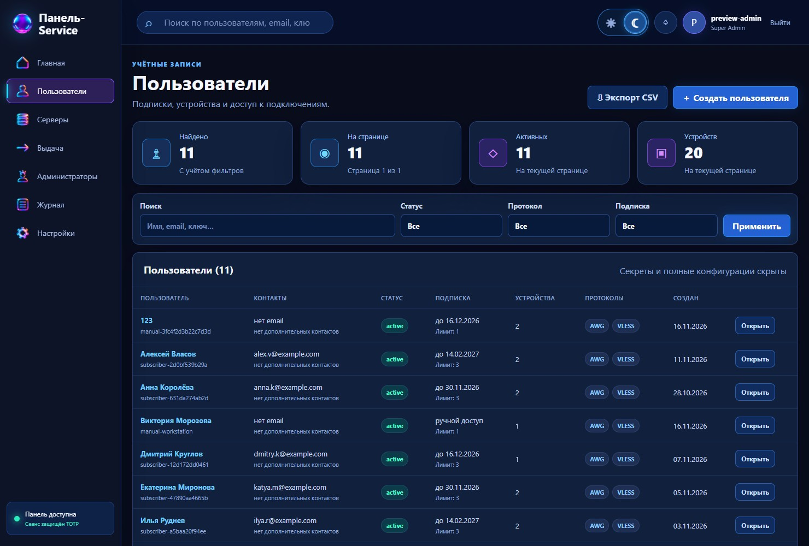

</details>

<details>
<summary>Карточка пользователя</summary>

Смотрите устройства, протоколы и статус каждого доступа. Для ручных доступов здесь можно добавить или удалить устройство.

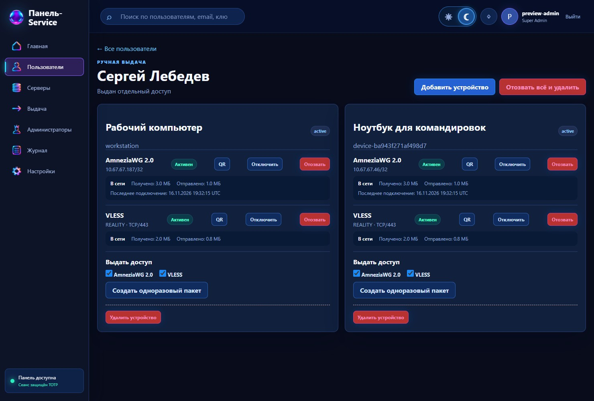

</details>

<details>
<summary>Серверы</summary>

Смотрите узлы и маршруты на карте, проверяйте доступность и задержку.

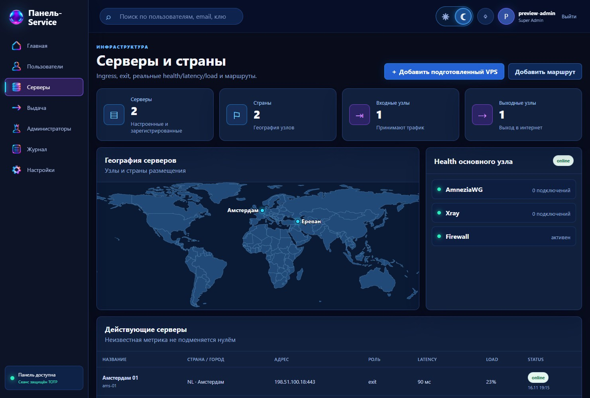

</details>

<details>
<summary>Выдача</summary>

Создавайте отдельный доступ по протоколу, указывайте срок и лимит устройств. Пакет конфигураций доступен по одноразовой ссылке.

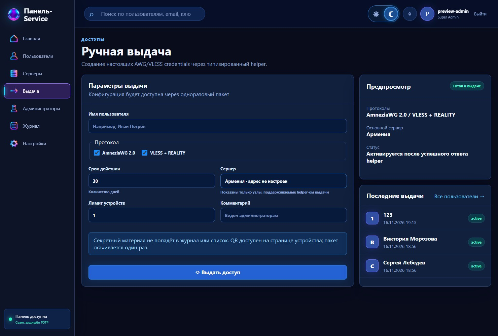

</details>

<details>
<summary>Администраторы</summary>

Настраивайте роли, разрешения и TOTP, просматривайте и завершайте сессии.

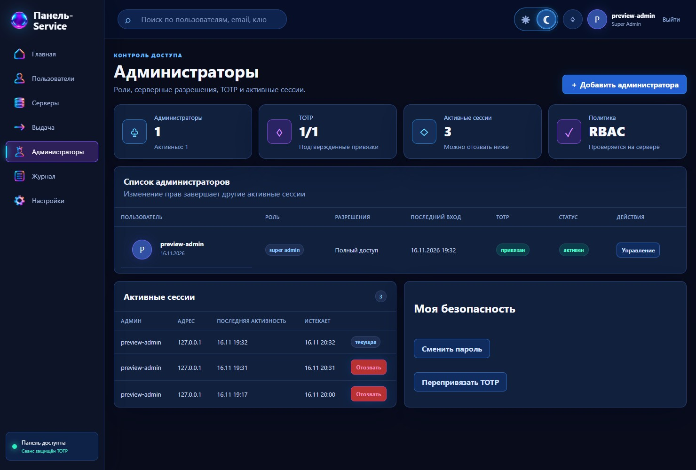

</details>

<details>
<summary>Журнал</summary>

Фильтруйте действия по дате и результату, просматривайте события и экспортируйте журнал.

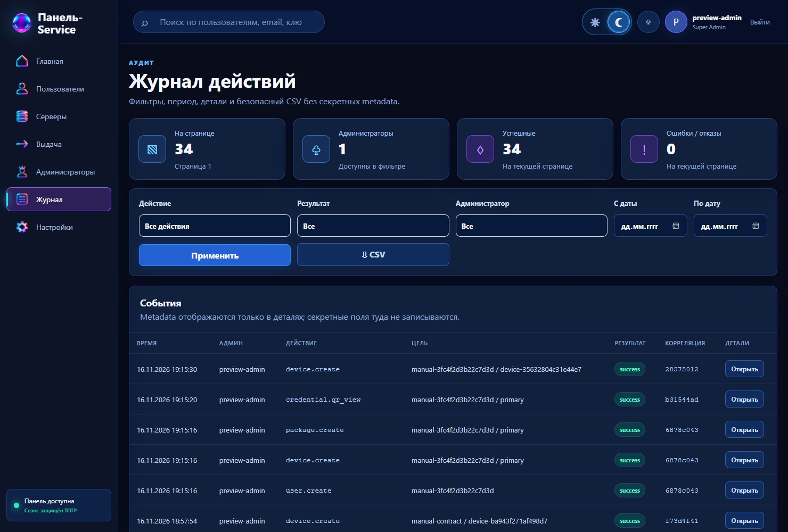

</details>

<details>
<summary>Настройки · Основные</summary>

Политики работы панели и сервисные параметры.

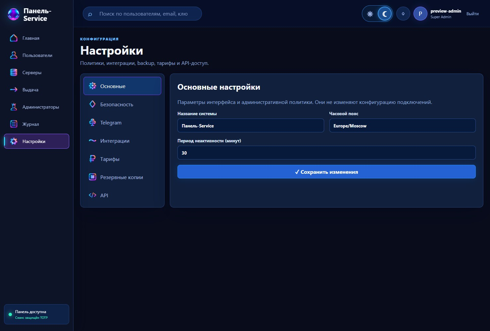

</details>

<details>
<summary>Настройки · Безопасность</summary>

Сеансы, пароль, TOTP и ограничения входа.

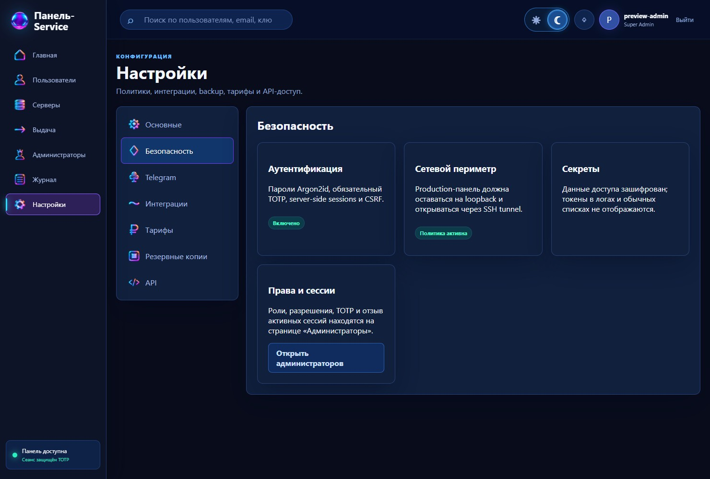

</details>

<details>
<summary>Настройки · Telegram</summary>

Категории уведомлений, получатели и журнал доставки.

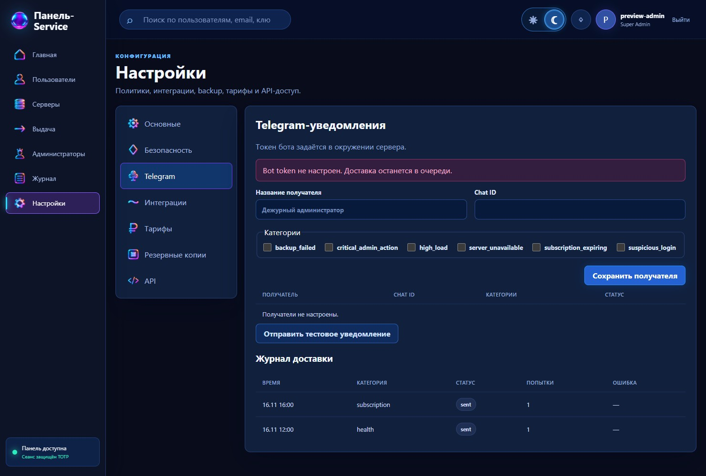

</details>

<details>
<summary>Настройки · Интеграции</summary>

Сведения о подключении внешних сервисов и платёжного провайдера.

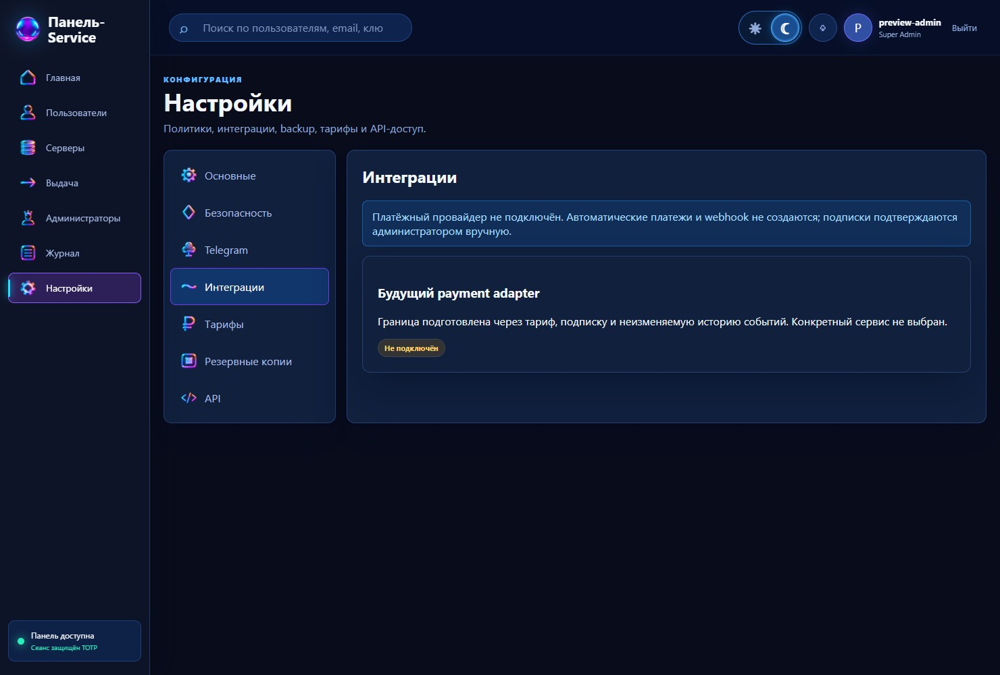

</details>

<details>
<summary>Настройки · Тарифы</summary>

Срок, цена, валюта и лимит устройств для каждого тарифа.

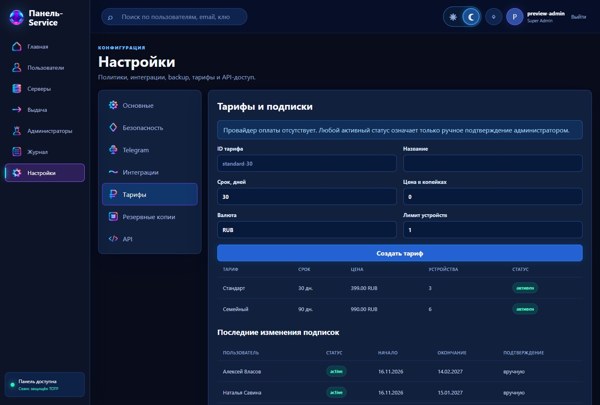

</details>

<details>
<summary>Настройки · Резервные копии</summary>

Политика шифрования, статус архивов и порядок восстановления.

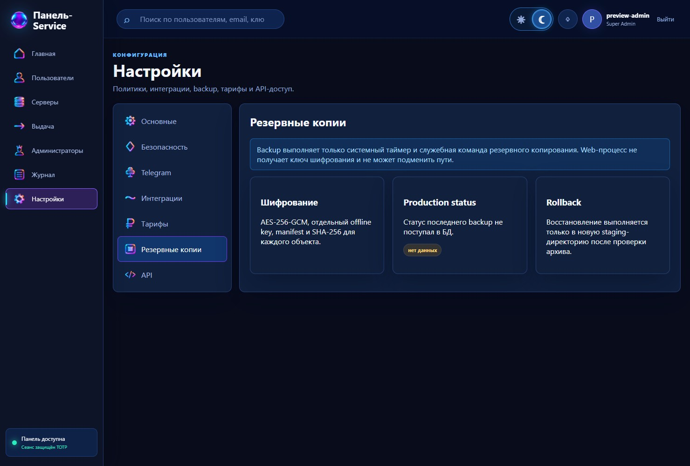

</details>

<details>
<summary>Настройки · API</summary>

Управление токенами API и их разрешениями.

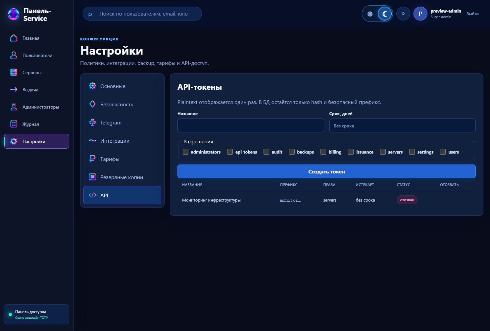

</details>

Скриншоты сняты в локальном режиме на демонстрационных данных. [Светлая тема](docs/images/new/overview-light.jpg) доступна через переключатель в правом верхнем углу.

## Как устроен проект

- **Python и FastAPI** — веб-маршруты, права доступа и HTTPS API. **Jinja2** выводит страницы.
- **SQLAlchemy, Alembic, PostgreSQL** — хранение данных и миграции. Для локальной проверки можно использовать SQLite.
- **Argon2 и TOTP** — пароль и одноразовый код для входа. Служебные операции выполняет отдельный системный компонент.
- **API** — `/api/v1/activate` активирует доступ для Windows-клиента. `/api/v2/activate`, `/api/v2/subscription` и `/api/v2/locations` обслуживают отдельный сценарий работы с устройствами и маршрутами. Telegram Bot API используется для настроенных уведомлений и поддержки.
- **Мониторинг** — трафик считается по накопительным счётчикам соседних замеров. Просроченные данные показываются как недоступные. Границы на карте взяты из [Natural Earth](https://www.naturalearthdata.com/downloads/110m-cultural-vectors/110m-admin-0-countries/).

Сценарии и модели лежат в `application/` и `domain/`, хранение и интеграции — в `infrastructure/`, маршруты и шаблоны — в `web/`. [Подробности API](docs/client-api.md)

## Запуск и проверка

Для локального запуска нужен Python 3.12 или новее. По [инструкции разработки](DEVELOPMENT.md#быстрый-старт-для-разработки) установите зависимости, создайте локальную базу и первого администратора. После запуска откройте [локальную панель](http://127.0.0.1:8000).

```powershell
ruff check .
mypy src
pytest
```
