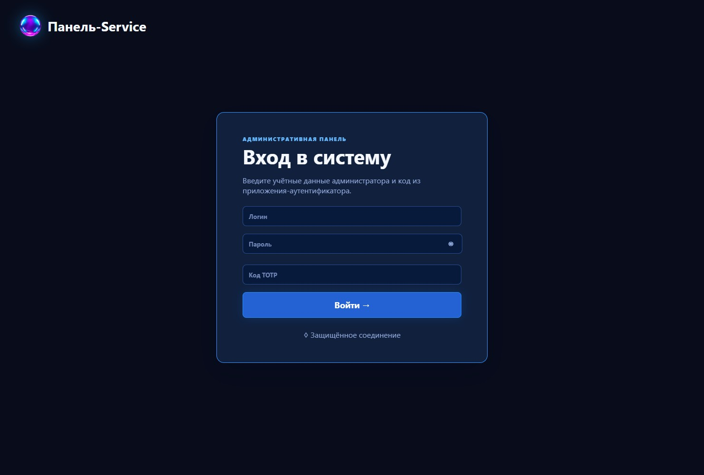
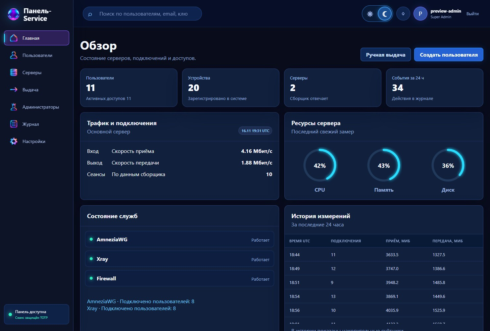
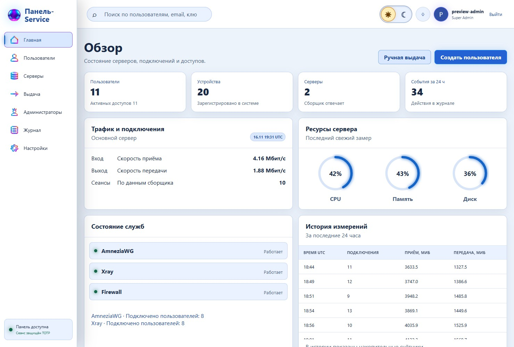
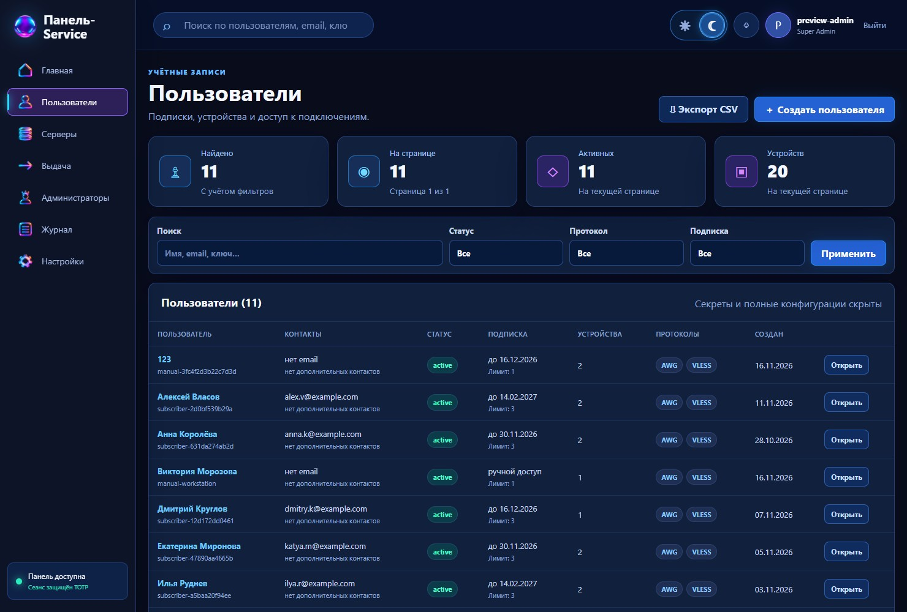
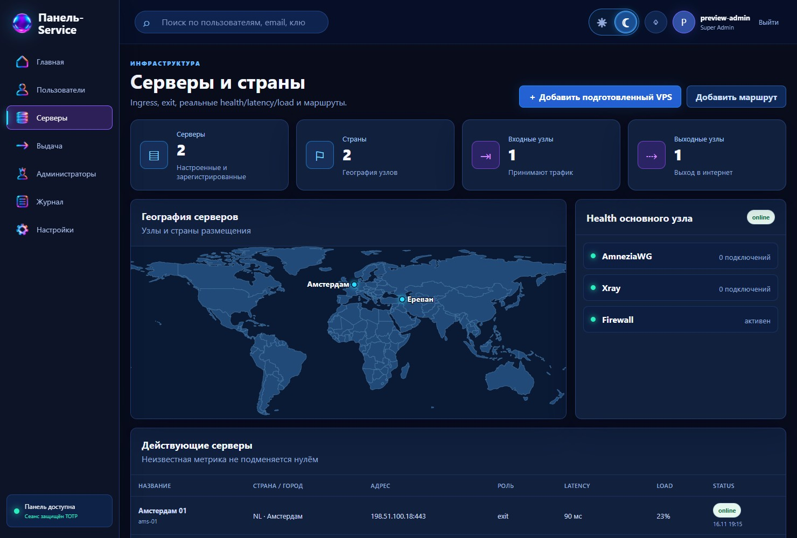
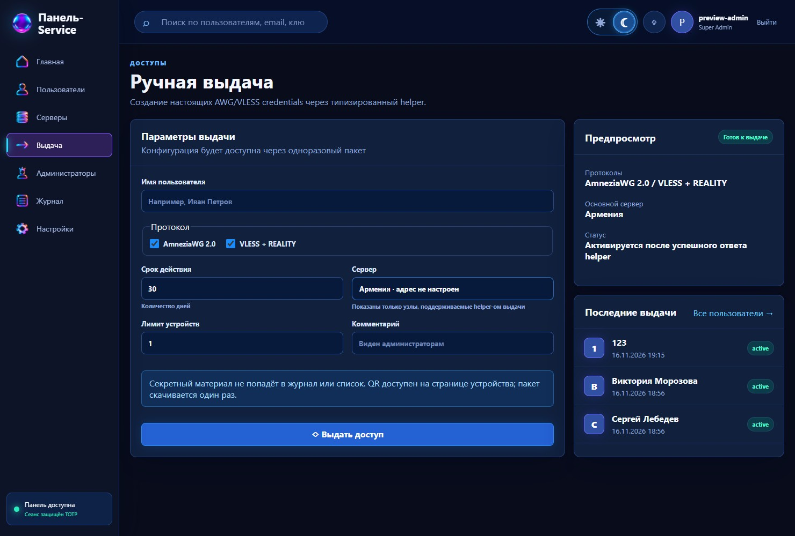
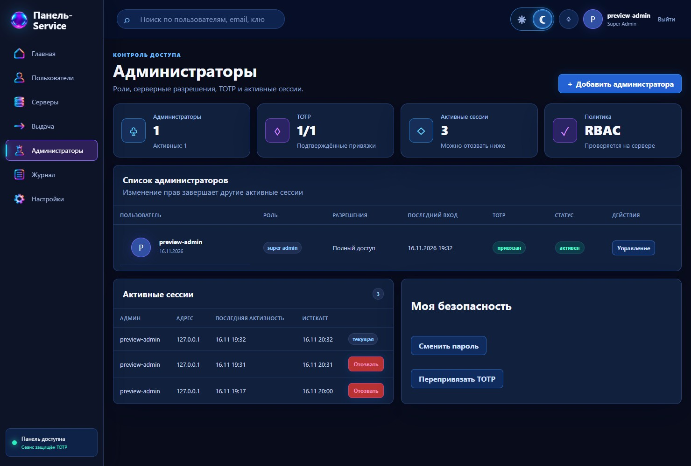
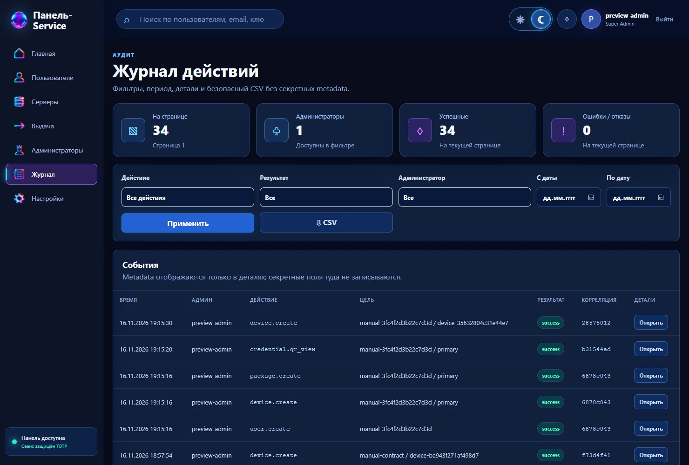
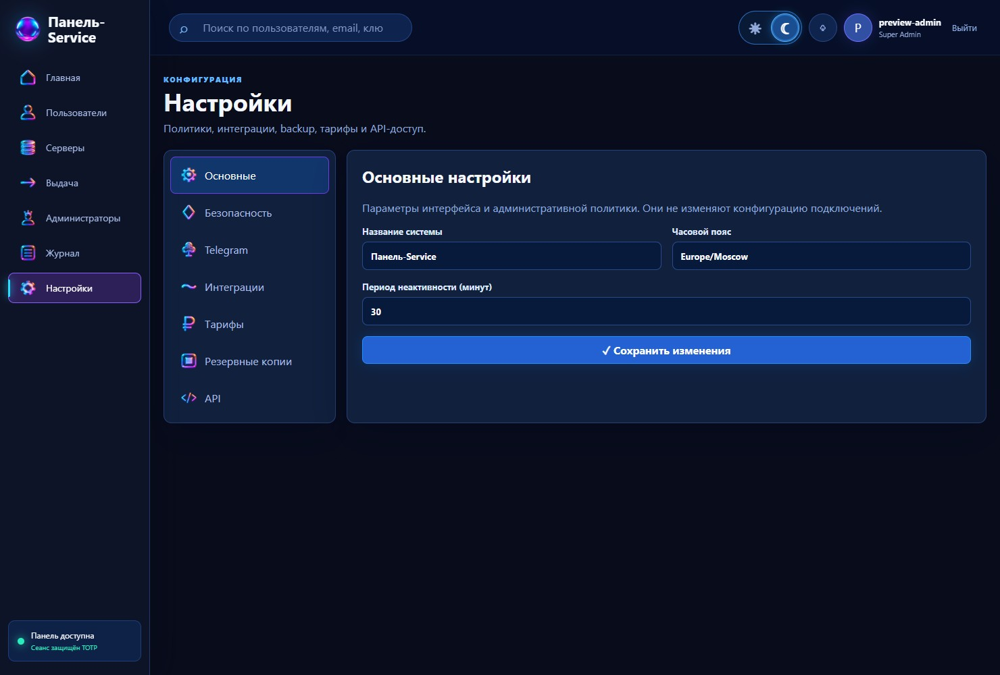

# Разделы Панели-Service

[Вернуться в README](../README.md)

## Вход

Вход администратора по паролю и коду TOTP.

## Обзор

Нагрузка, подключения, скорость трафика и состояние служб.

## Пользователи

Таблица подписок и доступов с фильтрами.

## Серверы

Узлы и локации, доступные в панели.

## Выдача

Форма создания доступа для отдельного устройства.

## Администраторы

Учётные записи и управление правами.

## Журнал

История действий и фильтры.

## Настройки

Политики, интеграции, резервные копии и уведомления.

[Скриншоты всех подразделов настроек](../README.md#разделы-панели)
